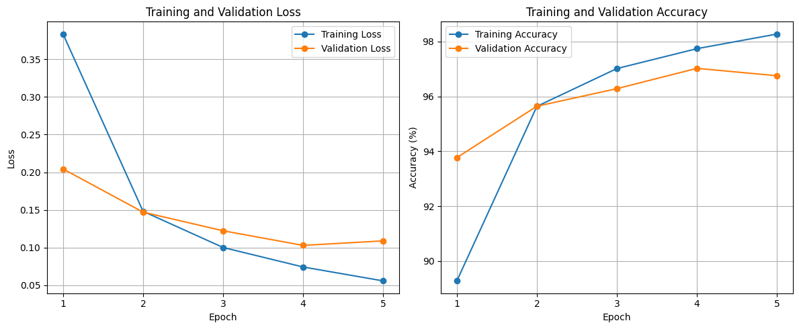
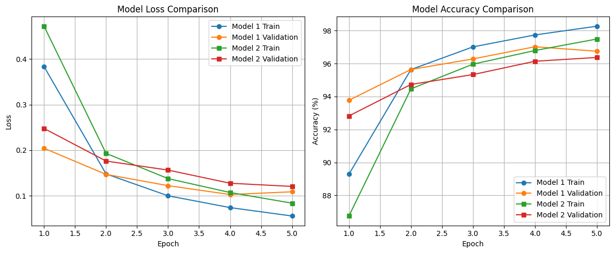
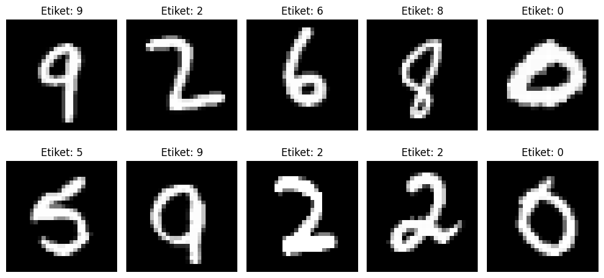

# MNIST Handwritten Digit Recognition Using MLP

## 1. Project Overview

The aim of this project is to develop and evaluate a Multi-Layer Perceptron (MLP) model for handwritten digit recognition using the MNIST dataset.

Two different MLP architectures were trained and compared. In addition, a handwritten student ID number was processed and evaluated to investigate how well a model trained on MNIST generalizes to real-world handwriting.

**Convolutional Neural Networks (CNNs) and pretrained models were not used. Both models were trained from scratch.**

## 2. Dataset

The MNIST dataset contains handwritten digits from 0 to 9.

- Image size: 28 × 28 pixels
- Image format: Grayscale
- Number of classes: 10
- Original training dataset: 60,000 images
- Training set: 50,000 images
- Validation set: 10,000 images
- Test set: 10,000 images

The original MNIST training dataset was divided into training and validation subsets using `random_split` with a fixed random seed. The official MNIST test dataset was kept separate and used for final evaluation after selecting the model based on validation performance.

Images were converted to tensors and normalized to the range [0, 1].

## 3. Technologies Used

- Python
- PyTorch
- Torchvision
- NumPy
- Matplotlib
- OpenCV
- Pillow
- Google Colab

## 4. MLP Architectures

Two MLP architectures were implemented and trained from scratch.

### Model 1: Baseline MLP

| Layer | Configuration |
|---|---|
| Input layer | 784 features |
| Hidden layer 1 | 256 neurons, ReLU |
| Hidden layer 2 | 128 neurons, ReLU |
| Output layer | 10 neurons |

### Model 2: Smaller MLP

| Layer | Configuration |
|---|---|
| Input layer | 784 features |
| Hidden layer 1 | 128 neurons, ReLU |
| Hidden layer 2 | 64 neurons, ReLU |
| Output layer | 10 neurons |

Each 28 × 28 image was flattened into a 784-dimensional vector before being passed to the network. The output layer contains 10 neurons, corresponding to the digit classes from 0 to 9.

## 5. Training Configuration

The following hyperparameters were used in both experiments.

| Hyperparameter | Value |
|---|---|
| Loss function | CrossEntropyLoss |
| Optimizer | Adam |
| Learning rate | 0.001 |
| Batch size | 128 |
| Number of epochs | 5 |
| Activation function | ReLU |
| Random seed | 42 |
| Device | CPU |
| Model initialization | From scratch |

Training and validation loss and accuracy were recorded at each epoch. The best architecture was selected based on validation accuracy rather than test accuracy.

## 6. Experimental Results

### Model 1: Training and Validation Results

| Epoch | Training Loss | Validation Loss | Training Accuracy | Validation Accuracy |
|---|---:|---:|---:|---:|
| 1 | 0.3835 | 0.2043 | 89.28% | 93.77% |
| 2 | 0.1481 | 0.1471 | 95.64% | 95.64% |
| 3 | 0.1001 | 0.1223 | 97.01% | 96.28% |
| 4 | 0.0742 | 0.1029 | 97.74% | 97.02% |
| 5 | 0.0558 | 0.1089 | 98.27% | 96.75% |

- Training time: 47.86 seconds
- Best validation accuracy: 97.02%
- Test loss: 0.0911
- Test accuracy: 97.29%

### Model 2: Training and Validation Results

| Epoch | Training Loss | Validation Loss | Training Accuracy | Validation Accuracy |
|---|---:|---:|---:|---:|
| 1 | 0.4721 | 0.2478 | 86.75% | 92.82% |
| 2 | 0.1931 | 0.1763 | 94.46% | 94.73% |
| 3 | 0.1378 | 0.1565 | 95.96% | 95.33% |
| 4 | 0.1073 | 0.1276 | 96.79% | 96.14% |
| 5 | 0.0839 | 0.1206 | 97.49% | 96.37% |

- Training time: 43.31 seconds
- Best validation accuracy: 96.37%

### Model Comparison

| Metric | Model 1 | Model 2 |
|---|---:|---:|
| Hidden layers | 256, 128 | 128, 64 |
| Best validation accuracy | 97.02% | 96.37% |
| Training time | 47.86 seconds | 43.31 seconds |
| Test accuracy | 97.29% | Not evaluated |

Model 1 achieved higher validation accuracy and was selected for final testing. Model 2 trained faster but achieved slightly lower validation accuracy.

The test dataset was not used to select the model or tune its hyperparameters. Only Model 1 was evaluated on the test dataset after model selection.

## 7. Training Curves

Training and validation loss and accuracy curves were plotted to observe how the models learned over five epochs.

### Model 1: Training Results



### Model Comparison



The training loss decreased throughout training for both models. Model 1 achieved a higher validation accuracy than Model 2. The increase in Model 1's validation loss during the final epoch, together with the decrease in validation accuracy, may indicate the beginning of overfitting.

## 8. Handwritten Student ID Recognition

A handwritten student ID number was used to evaluate the selected model on data outside the MNIST dataset.

The original handwritten image was processed using the following steps:

1. Convert the image to grayscale.
2. Improve contrast and apply thresholding.
3. Detect individual digit regions using connected components.
4. Sort the detected digits from left to right.
5. Convert each digit to a 28 × 28 image.
6. Resize each digit to fit within a 20 × 20 region and center it on a black 28 × 28 background.
7. Normalize pixel values to the range [0, 1].
8. Use the trained MLP to predict each digit.

### Handwritten Digit Results

- Actual student ID: `24120205065`
- Predicted student ID: `25920205055`
- Correctly predicted digits: 8 out of 11
- Digit-level accuracy: 72.73%



The model correctly classified 8 of the 11 detected digits. Its performance on the handwritten student ID was lower than its accuracy on the MNIST test dataset.

This difference demonstrates the **distribution shift** between MNIST images and real-world handwriting. Differences in digit shape, stroke thickness, spacing, image contrast, and preprocessing can affect predictions. The relatively low confidence scores for several digits also indicate uncertainty in some predictions.

## 9. Overall Evaluation

The experiments show that an MLP with two hidden layers can achieve high accuracy on the MNIST dataset without using a CNN or a pretrained model.

Model 1, with 256 and 128 neurons in its hidden layers, achieved a best validation accuracy of 97.02% and a test accuracy of 97.29%. Model 2, with 128 and 64 neurons, required less training time but achieved a lower best validation accuracy of 96.37%.

The comparison illustrates that changing the number of neurons in the hidden layers affects both classification performance and training time.

Although Model 1 performed well on MNIST, its digit-level accuracy on the handwritten student ID was 72.73%. This result highlights the difference between recognizing standardized handwritten digits and recognizing digits written by an individual.

The results suggest that further improvements could be achieved through better preprocessing, more representative handwriting samples, and additional experiments with model architecture and hyperparameters.

## 10. How to Run the Project

1. Clone or download this repository.
2. Open `MNIST_MLP_Odevi (1).ipynb` in Google Colab or Jupyter Notebook.
3. Install the required libraries if they are not already available.

```bash
pip install torch torchvision numpy matplotlib opencv-python pillow
```

4. Ensure that the handwritten student ID image is available at the path specified in the notebook.
5. Run the notebook cells in order.

The MNIST dataset is downloaded automatically through Torchvision when needed.

## 11. Repository Structure

```text
mnist-mlp-digit-recognition/
├── MNIST_MLP_Odevi (1).ipynb
├── README.md
└── images/
    ├── training_results.png
    ├── model_comparison.png
    ├── handwriting_results.png
    └── 24120205065.jpg
```

The image filenames and notebook filename in this structure should match the files uploaded to the repository. The `images` directory should contain the training plots, model comparison plot, handwritten prediction result, and original handwritten student ID image.

## 12. Conclusion

This project demonstrates the implementation, training, and evaluation of MLP-based handwritten digit recognition. It includes a comparison of two network architectures, training and validation curves, final test evaluation, and an experiment using a personally handwritten student ID.

The results emphasize that strong performance on a standard dataset does not necessarily guarantee equally strong performance on real-world handwriting.
